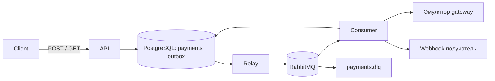

# Платёжный сервис

FastAPI принимает платёж, PostgreSQL хранит его и outbox, RabbitMQ доставляет работу consumer. Gateway эмулируется; реального списания нет. Нужны Docker Compose, Python 3.12, uv 0.11.27 и make. Локальные порты слушают только 127.0.0.1. Значения в `.env.example` предназначены только для локальной демонстрации.



## Запуск и демонстрация

```sh
cp -n .env.example .env                  # существующий .env не перезаписывается
docker compose --profile demo up -d --build --wait
docker compose ps
```

`migrate` выполняется перед API и consumer; профиль `demo` запускает получатель на порту 8080. `PAYMENT_WEBHOOK_ALLOWED_ORIGINS` — JSON-массив разрешённых origin; для demo разрешён `http://callback:8080`. Ключ из `.env` должен содержать минимум 32 символа после удаления пробелов по краям. Все HTTP endpoints, включая `/ready`, `/docs` и `/openapi.json`, требуют статический `X-API-Key`; Swagger UI не добавляет заголовок самостоятельно.

```bash
export KEY=local-development-api-key-change-me-123456
export BODY='{"amount":"12.34","currency":"USD","description":"Заказ","metadata":{"order":1},"webhook_url":"http://callback:8080/ok"}'
curl -sS -H "X-API-Key: $KEY" http://127.0.0.1:8000/ready
curl -sS -H "X-API-Key: $KEY" -H 'Idempotency-Key: demo-1' -H 'Content-Type: application/json' -d "$BODY" http://127.0.0.1:8000/api/v1/payments
# Повтор вернёт тот же payment_id и текущий статус:
curl -sS -H "X-API-Key: $KEY" -H 'Idempotency-Key: demo-1' -H 'Content-Type: application/json' -d "$BODY" http://127.0.0.1:8000/api/v1/payments
# Другая сумма с тем же ключом: HTTP 409
curl -sS -i -H "X-API-Key: $KEY" -H 'Idempotency-Key: demo-1' -H 'Content-Type: application/json' -d "${BODY/12.34/13.34}" http://127.0.0.1:8000/api/v1/payments
# Подставьте payment_id из ответа:
curl -sS -H "X-API-Key: $KEY" http://127.0.0.1:8000/api/v1/payments/PAYMENT_UUID
curl -sS http://127.0.0.1:8080/        # полученные callback
```

Для повторов используйте новый `Idempotency-Key` и URL `http://callback:8080/flaky` (первый запрос вернёт 500) или `/fail` (все запросы вернут 500, затем событие попадёт в DLQ). Получатель хранит события в памяти до перезапуска. DLQ можно просмотреть через RabbitMQ UI `http://127.0.0.1:15673` (payments/payments) или без удаления сообщений:

```sh
curl -sS -u payments:payments -H 'Content-Type: application/json' \
  -d '{"count":10,"ackmode":"ack_requeue_true","encoding":"auto"}' \
  http://127.0.0.1:15673/api/queues/%2F/payments.dlq/get
```

```sh
docker compose --profile demo stop       # сохранить данные
docker compose --profile demo down       # удалить контейнеры, сохранить volumes
docker compose --profile demo down -v    # сбросить все локальные платежи и очереди
```

## Проверки

`make bootstrap` запускает PostgreSQL/RabbitMQ и идемпотентно создаёт `payments_test` DB и vhost, затем применяет миграции. Для bootstrap используйте порты по умолчанию 55432 и 5673. Интеграционные фикстуры очищают эти ресурсы: не храните в них нужные данные. E2E создаёт отдельные Compose-проекты, порты и volumes и удаляет их после проверки. Нужны доступ к Docker и сети для аудита зависимостей.

```sh
make sync
make format lint typecheck
make unit
make bootstrap
make integration
make smoke
make audit
make logs                                # reports/compose.log
# или все тесты: make test
```

JUnit и coverage unit/integration сохраняются в `reports/`; при ошибке E2E выводит логи своего проекта до его удаления и сохраняет их в JUnit. Coverage контейнерных процессов не измеряется. CI выполняет те же цели и сохраняет отчёты и логи при ошибке.

## Поведение и ограничения

- POST требует `Idempotency-Key`, возвращает 202; повтор эквивалентного запроса возвращает тот же ID и текущий статус. Изменение тела — 409; неверный запрос — 422, ключ API — 401, неизвестный платёж — 404. Сумма положительная, до 18 цифр и двух знаков, RUB/USD/EUR; JSON-число и строка разбираются точно, в ответе сумма строка.
- Эмулятор работает 2–5 секунд и в 10% случаев возвращает конечный `failed`; callback отправляется и для `failed`. Обе ветви проверяются детерминированными тестами; Compose E2E принимает любой конечный статус.
- Три логические попытки отдельно для gateway и webhook, задержки 1 и 2 секунды. После трёх исключений обработки неизвестный результат остаётся `pending`, событие попадает в DLQ. Отказ webhook не меняет конечный статус. Ошибки БД и публикации повторяются отдельно; malformed/future/unknown события идут в native DLX.
- Доставка как минимум один раз: после сбоя HTTP может вызваться повторно с тем же `event_id`. Получатель должен дедуплицировать его. Блокировки строк удерживаются во время ограниченного I/O, что ограничивает пропускную способность. [Решение о транзакциях](docs/adr/001-transactions.md), [доставке и блокировках](docs/adr/002-delivery.md).

## Требования и проверки

| Требование | Код | Именованный тест |
|---|---|---|
| Auth, валидация и точная сумма | `app.py`, `schemas.py` | `test_auth_and_validation`, `test_numeric_amount_preserves_precision_and_string_equivalence` |
| Идемпотентность и атомарный outbox | `service.py`, `repositories.py` | `test_concurrent_identical_requests_commit_one_payment_and_outbox`, `test_outbox_failure_rolls_back_payment` |
| Публикация, восстановление, блокировка | `outbox_relay.py` | `test_confirm_then_database_failure_replays_same_event`, `test_concurrent_relays_skip_locked_row` |
| Оба результата gateway и повтор callback | `consumer.py`, `webhook.py` | `test_terminal_result_committed_before_webhook_and_duplicates_ignored`, `test_webhook_retry_preserves_outcome_and_notification_id` |
| DLQ и poison | `consumer.py`, `worker.py` | `test_three_stage_failures_create_one_dead_continuation`, `test_real_subscriber_ack_and_poison_native_dlx` |
| Восстановление инфраструктуры | `compose.yaml` | `test_compose_recovers_pending_work_and_delivers_callbacks`, `test_rabbitmq_message_survives_container_recreation` |
